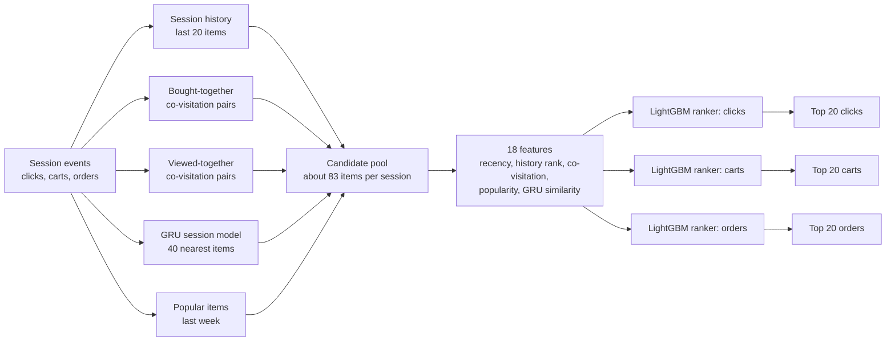

# Two-Stage E-commerce Recommender (OTTO)

Predicts which products a shopper will **click, add to cart and order next**, from their current browsing session.
Built on 216.7M real e-commerce events from OTTO, with five candidate sources (including a PyTorch GRU session model),
LightGBM rankers, Spark feature pipelines and a FastAPI service in Docker.

**Result:** 0.5519 Recall@20 on a held-out final week, vs 0.5276 for the best baseline (+4.6%),
with gains on clicks, carts and orders. The whole pipeline rebuilds from raw data with one script.

## Results

Recall@20 on the final week of data (1.80M sessions), weighted the OTTO way: `0.10 × clicks + 0.30 × carts + 0.60 × orders`.

| System | Clicks | Carts | Orders | **Score** |
|---|---|---|---|---|
| Popular items only | 0.0053 | 0.0067 | 0.0060 | 0.0061 |
| Session history + popular | 0.3259 | 0.3122 | 0.5736 | 0.4704 |
| History + bought-together + popular | 0.4244 | 0.3831 | 0.6170 | 0.5276 |
| v1: two-stage, 4 sources, one blended list | 0.4730 | 0.4004 | 0.6282 | 0.5443 |
| **v2: + viewed-together source, separate list per type** | **0.4968** | **0.4087** | **0.6327** | **0.5519** |

The final system was chosen on held-out sessions from the week before, and the test week was scored once.
Adding the viewed-together source was worth about five times as much as changing how the lists are merged.
Full write-up, step-by-step gains, findings and limitations: [RESULTS.md](RESULTS.md).

## How it works



1. **Candidates.** Five sources propose items: the shopper's own recent items, items often bought together with them,
   items often viewed within 24 hours of them, the nearest items to a GRU session embedding (PyTorch, trained with
   in-batch negatives), and last week's popular items.
2. **Ranking.** Three LightGBM lambdarank models score every candidate for click, cart and order, and each produces
   its own top 20. Time since the shopper last touched an item is the strongest signal.
3. **Serving.** `src/serve.py` re-implements the feature pipeline in NumPy/pandas for single sessions behind a
   FastAPI endpoint. It currently serves v1 (four sources, one blended list).

## Evaluation design (no future data in training)

- **Test week:** sessions that start in the final 7 days (1.80M sessions). Each is cut at a random point; the model sees the events
  before the cut and is scored on the next click, carted items and ordered items after it.
- Co-visitation counts, popularity and the GRU used for the test week are built only from events **before** the test week.
- **Ranker week:** the same procedure one week earlier (2.24M sessions), with a GRU trained only on weeks 1–2.
  Rankers train on 300K of these sessions; the other 1.94M are held out for choosing between systems.
- Scores are not comparable to the Kaggle leaderboard, which uses OTTO's hidden test set.

## Project structure

```
src/
  split.py       time-based split and test labels (Spark)
  metrics.py     Recall@20, OTTO weighting
  baselines.py   popularity, bought-together and viewed-together tables
  features.py    candidates, ranker features and labels (Spark)
  model.py       GRU session model and loss (PyTorch)
  retrieval.py   session encoding and nearest-item search
  ranking.py     feature sets, per-type top-20 lists, OTTO scoring
  serve.py       single-session two-stage pipeline (NumPy/pandas)
  api.py         FastAPI service
scripts/         one script per pipeline step (see below)
tests/           pytest tests for split, metrics, baselines, features, model, retrieval, ranking and API
notebooks/
  01_data_exploration.ipynb   event types, activity, session lengths, item popularity
  02_results.ipynb            tables and charts read from reports/
reports/         every score and model summary, written by the scripts as JSON
RESULTS.md       results, findings, limitations
run_pipeline.sh  the full pipeline, raw data to final score
Dockerfile       API image (CPU)
```

## Run it

**Requirements:** Python 3.12+, Java 21 (for Spark), about 30 GB free disk.

```bash
python -m venv .venv
source .venv/bin/activate
pip install -r requirements.txt
pytest
```

**Data:** download the OTTO dataset from [Kaggle](https://www.kaggle.com/datasets/otto/recsys-dataset)
and put `otto-recsys-train.jsonl` in `data/raw/`.

**Pipeline:** `./run_pipeline.sh` runs every step in order. Each step is also a script you can run on its own:

| Step | Script |
|---|---|
| Events, time split, labels | `python -m scripts.prepare_data` |
| Baselines | `python -m scripts.baselines` |
| GRU and its candidates (per week) | `python -m scripts.train_gru --week rank`, `python -m scripts.gru_candidates --week rank` |
| Candidates and features (per week, per version) | `python -m scripts.build_features --week rank --version v2` |
| Rankers | `python -m scripts.train_rankers --version v2` |
| Compare systems on held-out sessions | `python -m scripts.evaluate_ranking --versions v1 v2 --seed 42` |
| Score the test week (once) | `python -m scripts.evaluate_ranking --versions v1 v2 --final` |

Then run the two notebooks to see the data and the results.

**API:**

```bash
docker build -t otto-recsys .
docker run --rm -p 8000:8000 otto-recsys

curl localhost:8000/health
curl -X POST localhost:8000/recommend \
  -H "Content-Type: application/json" \
  -d '{"events": [{"aid": 1517085, "ts": 1659304800, "type": 0}], "k": 20}'
```

The response is a list of item IDs plus the request latency in milliseconds.

## Data

[OTTO Recommender Systems Dataset](https://github.com/otto-de/recsys-dataset) by OTTO, licensed under
[CC BY 4.0](https://creativecommons.org/licenses/by/4.0/). Item IDs are anonymized.
