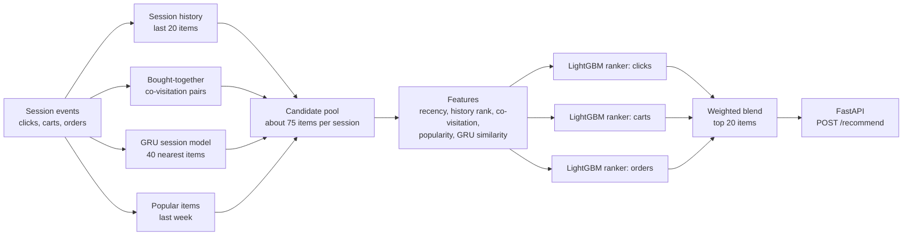

# Two-Stage E-commerce Recommender (OTTO)

Predicts which products a shopper will **click, add to cart and order next**, from their current browsing session.
Built on 216.7M real e-commerce events from OTTO, with a candidate-retrieval stage (including a PyTorch GRU session model),
LightGBM rankers, Spark feature pipelines and a FastAPI service in Docker.

**Result:** 0.5446 Recall@20 on a held-out final week, vs 0.5276 for the best baseline (+3.2%), with gains on clicks, carts and orders.

## Results

Recall@20 on the final week of data, weighted the OTTO way: `0.10 × clicks + 0.30 × carts + 0.60 × orders`.

| System | Clicks | Carts | Orders | **Score** |
|---|---|---|---|---|
| Popular items only | 0.0053 | 0.0067 | 0.0060 | 0.0061 |
| Session history + popular | 0.3259 | 0.3122 | 0.5736 | 0.4704 |
| History + bought-together + popular | 0.4244 | 0.3831 | 0.6170 | 0.5276 |
| **Two-stage: 4 candidate sources + LightGBM rankers** | **0.4727** | **0.4006** | **0.6285** | **0.5446** |

A perfect ranker over the same candidate pool would reach 0.5717, so the ranker captures about 40% of the possible gain over the baseline;
most remaining misses never reach the candidate pool. Full write-up, ablation and limitations: [RESULTS.md](RESULTS.md).

## How it works



1. **Candidates.** Four sources propose items: the shopper's own recent items, items often bought together with them,
   the nearest items to a GRU session embedding (PyTorch, trained with in-batch negatives), and last week's popular items.
2. **Ranking.** Three LightGBM models score every candidate for click, cart and order, using 16 features.
   Time since the shopper last touched an item is the strongest signal.
3. **Serving.** `src/serve.py` re-implements the Spark feature pipeline in NumPy/pandas for single sessions;
   on a 200-session check it produced the same candidates as the Spark pipeline for all 200 sessions.

## Evaluation design (no future data in training)

- **Test week:** sessions that start in the final 7 days (1.80M sessions). Each is cut at a random point; the model sees the events
  before the cut and is scored on the next click, carted items and ordered items after it.
- Co-visitation counts, popularity and the GRU used for the test week are built only from events **before** the test week.
- **Ranker training:** the same procedure one week earlier (2.24M sessions), with a GRU trained only on weeks 1–2.
- Scores are not comparable to the Kaggle leaderboard, which uses OTTO's hidden test set.

## Project structure

```
src/
  split.py       time-based split and test labels (Spark)
  metrics.py     Recall@20, OTTO weighting
  baselines.py   popularity and bought-together baselines
  features.py    candidates, ranker features and labels (Spark)
  model.py       GRU session model and loss (PyTorch)
  retrieval.py   session encoding and nearest-item search
  serve.py       single-session two-stage pipeline (NumPy/pandas)
  api.py         FastAPI service
tests/           pytest tests for split, metrics, baselines, features, model, retrieval and API
notebooks/
  01_explore.ipynb     load data with Spark, split, labels, first baselines
  02_baselines.ipynb   baselines, ranker training, final evaluation, serving check
  03_retrieval.ipynb   GRU training and candidate retrieval
RESULTS.md       results, ablation, findings, limitations
Dockerfile       API image (CPU)
```

## Run it

**Requirements:** Python 3.12+, Java 21 (for Spark), about 30 GB free disk.

```bash
python -m venv .venv
source .venv/bin/activate
pip install -r requirements.txt
pytest
```

**Data:** download the OTTO dataset from [Kaggle](https://www.kaggle.com/datasets/otto/recsys-dataset)
and put `otto-recsys-train.jsonl` in `data/raw/`.

**Pipeline:** run `01_explore`, then `02_baselines` up to building the training sequences, then `03_retrieval`,
then the rest of `02_baselines`.

**API:**

```bash
docker build -t otto-recsys .
docker run --rm -p 8000:8000 otto-recsys

curl localhost:8000/health
curl -X POST localhost:8000/recommend \
  -H "Content-Type: application/json" \
  -d '{"events": [{"aid": 1517085, "ts": 1659304800, "type": 0}], "k": 20}'
```

The response is a list of item IDs plus the request latency in milliseconds.

## Data

[OTTO Recommender Systems Dataset](https://github.com/otto-de/recsys-dataset) by OTTO, licensed under
[CC BY 4.0](https://creativecommons.org/licenses/by/4.0/). Item IDs are anonymized.
